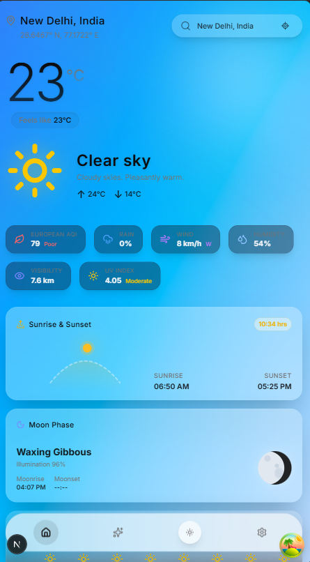
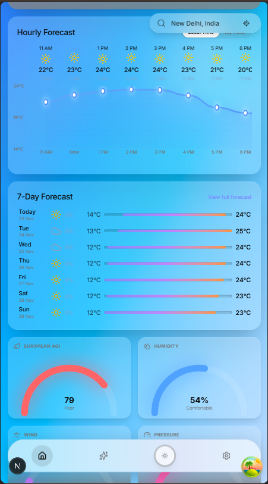
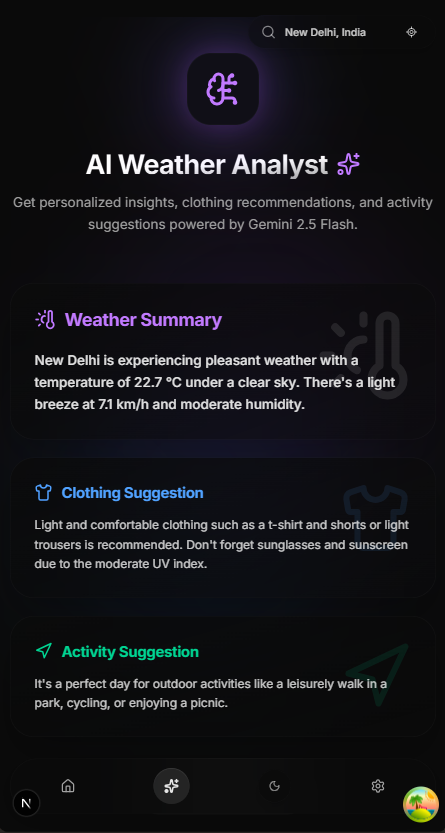
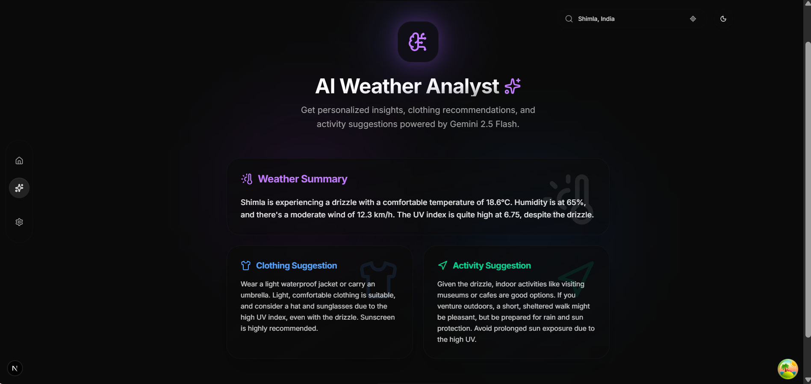

# WeatherWiseAI

**Weather and recommendations API** · Turn a location into current conditions, a forecast and a practical answer to “What should I wear or do today?” This stateless ASP.NET Core service powers the WeatherWiseAI dashboard and can also be called directly.

[](https://github.com/Rohit-0310/WeatherWiseAI-API/releases/tag/v1.0.0)
[](src/WeatherWiseAI.Api/WeatherWiseAI.Api.csproj)
[](https://github.com/Rohit-0310/WeatherWiseAI-API/actions/workflows/ci.yml)
[](LICENSE)
[](https://github.com/Rohit-0310/WeatherWiseAI-API)
[](https://github.com/Rohit-0310/WeatherWiseAI-API/forks)

**Release status** · [v1.0.0 pre-release](https://github.com/Rohit-0310/WeatherWiseAI-API/releases/tag/v1.0.0)

[Local setup](#local-setup) · [Configuration](#configuration) · [API endpoints](#api-endpoints) · [Screenshots](#screenshots) · [Architecture](#architecture) · [Testing](#testing) · [Deployment](#deployment) · [Contributing](#releases-and-contributing)

## WeatherWiseAI Repositories

| Repository | Role |
| --- | --- |
| [WeatherWiseAI-API](https://github.com/Rohit-0310/WeatherWiseAI-API) (this repository) | ASP.NET Core service for location lookup, weather data, astronomy and Gemini generation |
| [WeatherWiseAI-Web](https://github.com/Rohit-0310/WeatherWiseAI-Web) | Next.js dashboard for exploring forecasts and requesting recommendations |

The browser calls the API directly over HTTPS. The API handles the upstream provider requests and keeps the Gemini credential on the server.

## What the API provides

- **Weather and air quality.** Retrieve current conditions, European Air Quality Index (AQI) when available, hourly forecasts and daily temperature ranges. Weather requests support metric and imperial units.
- **Location lookup.** Search for a city with Open-Meteo geocoding or resolve coordinates through BigDataCloud. Reverse lookup can fall back to a coordinate label.
- **Sun and moon.** Combine Open-Meteo solar data with CoordinateSharp lunar calculations for the selected coordinates and date.
- **AI Weather Analyst.** Submit a weather snapshot to Gemini and receive three text fields for weather, clothing and activity. Ordinary weather requests work without a Gemini key.

## Local setup

Install Git and the .NET 10 SDK. Allow network access to NuGet for restore and to the providers for live requests. The API does not require a database.

```sh
git clone https://github.com/Rohit-0310/WeatherWiseAI-API.git
cd WeatherWiseAI-API
dotnet restore WeatherWiseAI.slnx
dotnet dev-certs https --trust
dotnet run --project src/WeatherWiseAI.Api --launch-profile https
```

The HTTPS profile selects Development and serves [Swagger UI](https://localhost:7008/) at the root. Use **Try it out** to send a request or open the [OpenAPI JSON](https://localhost:7008/swagger/v1/swagger.json). The [host health check](https://localhost:7008/health) probes the running application independently of upstream providers.

## Configuration

ASP.NET Core loads the checked-in settings, environment-specific settings and process environment overrides. Double underscores address nested configuration keys.

| Server environment variable | Purpose and default |
| --- | --- |
| `Gemini__ApiKey` | Supply privately through the server environment or host secret store to enable AI generation. |
| `Gemini__ModelName`, `Gemini__BaseUrl` | Override the configured model (`gemini-2.5-flash`) or Gemini service base. |
| `OpenMeteo__BaseUrl`, `OpenMeteo__TimeoutSeconds` | Forecast service base (default `https://api.open-meteo.com`) and Open-Meteo client timeout (default 30 seconds). |
| `Cors__AllowedOrigins__0` | Exact frontend origin, including scheme and port. Add indexed entries for additional origins. Development defaults to `http://localhost:3000`. Other environments default to an empty allowlist. |
| `ASPNETCORE_ENVIRONMENT`, `ASPNETCORE_URLS` | Select the environment and configure host listeners when running outside a launch profile. |

For example, to allow a browser running on a different local port, set the following in PowerShell before starting the API. The value is the browser origin, without an API path.

```powershell
$env:Cors__AllowedOrigins__0 = "http://localhost:3001"
```

## API endpoints

Base URL for the local HTTPS profile: `https://localhost:7008/api/v1`. These routes accept requests without caller credentials.

| Method | Path under `/api/v1` | Inputs and result |
| --- | --- | --- |
| GET | `/Location/search` | City `query`, optional `count` and `language`. Returns matching locations. |
| GET | `/Location/reverse` | Latitude and longitude, optional language. Returns a location. |
| GET | `/Weather/current` | Latitude and longitude, optional units and timezone. Returns conditions, wind, humidity, AQI and daily metrics. |
| GET | `/Weather/hourly` | Weather coordinates and options plus `hours` (1–48, default 24). Returns a time series. |
| GET | `/Weather/forecast` | Weather coordinates and options. Returns daily forecast entries. |
| GET | `/Weather/astronomy` | Latitude and longitude, optional `date`. Returns solar and lunar information. |
| POST | `/AiSummary` | JSON weather snapshot. Returns `summary`, `clothing` and `activity`. |

Try a city lookup, then request six forecast hours using its coordinates. For example, in a shell with curl:

```sh
curl "https://localhost:7008/api/v1/Location/search?query=New%20Delhi&count=5"
curl "https://localhost:7008/api/v1/Weather/hourly?latitude=28.61&longitude=77.21&hours=6&units=Metric"
```

Weather and location GETs return a JSON envelope with `data`, `success`, `errors` and nullable `meta`. For the hourly series, read `data.hours`. To try AI generation in Swagger UI, submit this example body to `POST /api/v1/AiSummary` with the server key configured.

```json
{
  "location": "New Delhi",
  "temperature": "25 °C",
  "condition": "Rain",
  "humidity": "80%",
  "wind": "12 km/h",
  "uvIndex": "2"
}
```

AI success returns its three fields directly. An AI adapter failure can return HTTP 400 with `error.message`. Binding and validation errors use an `errors` array. [Full API reference](docs/API_GUIDELINES.md) · [Error handling](docs/ERROR_HANDLING.md)

## Screenshots

These captures from the companion web dashboard follow one city from current conditions through the forecast to generated advice. Select a capture to read it at full size.

| Current weather and astronomy | Hourly and daily forecasts | AI weather, clothing and activity suggestions |
| --- | --- | --- |
| [](docs/screenshots/dashboard-mobile.png) | [](docs/screenshots/forecast-mobile.png) | [](docs/screenshots/ai-analyst-mobile.png) |

<details>
<summary>View the desktop AI Weather Analyst</summary>

[](docs/screenshots/ai-analyst-desktop.png)

</details>

## Architecture

The solution separates HTTP and provider contracts. For an hourly forecast, the controller binds the request, an Application service calls the weather provider interface, and Infrastructure requests Open-Meteo data through Refit. AutoMapper converts provider fields to the response DTO. Polly applies retries and a circuit breaker to the Open-Meteo client.

| Project or directory | Responsibility |
| --- | --- |
| `src/WeatherWiseAI.Api/` | ASP.NET Core controllers, dependency injection, validation filter, exception handling, Serilog and Development Swagger UI |
| `src/WeatherWiseAI.Application/` | Feature services, DTOs, provider interfaces, FluentValidation rules, mapping and astronomy |
| `src/WeatherWiseAI.Infrastructure/` | Open-Meteo Refit clients, reverse geocoding and typed HTTP client for Gemini |
| `src/WeatherWiseAI.Shared/` | Response envelopes, results and common error types |
| `src/WeatherWiseAI.Domain/` | Reserved domain project |
| `tests/WeatherWiseAI.Api.Tests/` | xUnit HTTP contract tests and provider fixtures |
| `docs/` | Architecture, API reference, contributor and deployment guides |

Follow the implementation from [hourly request to response](docs/ARCHITECTURE.md#trace-an-hourly-forecast) or from [AI request to recommendation](docs/ARCHITECTURE.md#trace-an-ai-suggestion).

## Testing

```sh
dotnet build WeatherWiseAI.slnx -c Release
dotnet test WeatherWiseAI.slnx -c Release --no-build
```

The contract suite uses provider fixtures to exercise HTTP responses, validation, mapping and CORS. To check live connectivity separately, run a weather request and generate a summary through Swagger with your own server-side key. [Development guide](docs/DEVELOPMENT_GUIDE.md)

## Deployment

Publish a framework-dependent build with the .NET 10 SDK. Install the ASP.NET Core 10 runtime on the target host and launch the published DLL.

```sh
dotnet publish src/WeatherWiseAI.Api -c Release -o artifacts/api
dotnet artifacts/api/WeatherWiseAI.Api.dll
```

Configure HTTPS, a writable log destination, provider egress, the server secret and the allowed web origin. Point the frontend build at the public API base ending in `/api/v1`. Before making the unauthenticated AI endpoint public, review provider quotas, access controls and the applicable CoordinateSharp and AutoMapper terms. [Deployment guide](docs/DEPLOYMENT.md)

## Releases and contributing

- [v1.0.0 pre-release](https://github.com/Rohit-0310/WeatherWiseAI-API/releases/tag/v1.0.0) · [Release history](https://github.com/Rohit-0310/WeatherWiseAI-API/releases) · [Changelog](docs/CHANGELOG.md) · [Candidate notes](docs/RELEASE_NOTES_V1.md)
- [Contributing](CONTRIBUTING.md) · [Security policy](SECURITY.md) · [Roadmap](docs/ROADMAP.md) · [Documentation index](docs/README.md)

The project is distributed under the [MIT License](LICENSE). Third-party dependencies have their own terms.
