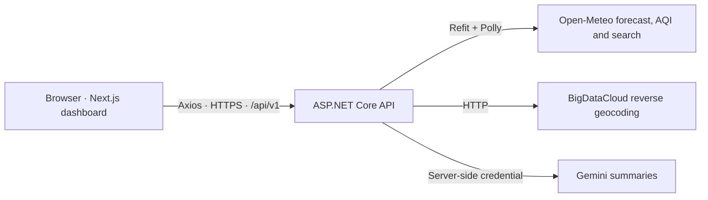

# WeatherWiseAI documentation audit

Scope: local API `cbaddc1` and Web `5b32876` on main. The existing local API settings edit was preserved. Source, project manifests, committed settings keys, repository history and local checks were used as evidence. The [API](https://github.com/Rohit-0310/WeatherWiseAI-API) and [Web](https://github.com/Rohit-0310/WeatherWiseAI-Web) are separate repositories.

## Contract findings

| Area | Current behavior and gap |
| --- | --- |
| Local setup | API launch profile and hardcoded frontend URL agree on HTTPS port 7008. CORS permits only HTTP localhost port 3000. Old frontend base URL env guidance was incorrect |
| JSON shapes | GETs use the shared envelope with nullable meta. AI success is plain JSON and upstream AI errors have a nested error field. Model binding and middleware can return the envelope. Frontend does not parse these errors consistently |
| Units and fields | Metric/Imperial work through forecast requests. AI client sends bare temperature and wind numbers as strings. Client current-weather types include fields not returned by the server. UV/precipitation chance on current weather come from daily maxima |
| Locations and time | Reverse geocoding falls back to a coordinate label and GMT. The frontend and backend require an agreed approach for provider-local timestamps and date boundaries |
| Validation and access | FluentValidation rules are registered but not invoked by the route pipeline. Astronomy DataAnnotations and MVC binding are active. No caller authentication or app-level rate limiting is wired |
| Hosted setup | Environment-based frontend URL and deployment-specific backend CORS are open work. Production and provider access have not been verified |

## Obsolete material corrected

- API: enterprise readiness claims, Swagger at /swagger, domain entities as an existing implementation, Open-Meteo reverse lookup, AI prompt builder wiring, universal validation, a single error shape, and implied provider-independent retries or caching.
- Web: Next.js 15 presented as current, public API URL/key environment examples, Radix UI, weather-driven theme mode, toast/error and retry claims, and Canvas precipitation descriptions. The mobile navigation and unit plan is historical and labeled accordingly.
- Both: initial changelog headings are historical entries, with no local release tags establishing them as published versions. Current functionality and future work are separated in the roadmaps.

## Public contributor and release gaps

Both repositories have an MIT license. Contribution instructions and security reporting guidance were added. No committed issue forms, PR template, GitHub Actions CI, automated test suite or versioned deployment configuration was found. Add bug and feature templates, a PR checklist with test evidence and contract impact, and separate CI that restores locked dependencies where available, builds, and runs tests. Establish private vulnerability reporting, dependency review, supported versions and a release checklist. Keep [Semantic Versioning](https://semver.org/) and note API changes that need coordinated frontend updates. No remote changes or release publication were performed.

Validation and blockers are in the local [API release draft](RELEASE_NOTES_V1.md) and the matching Web repository file `docs/RELEASE_NOTES_V1.md`. Neither is ready for a stable release. Prioritize dependency advisories and API validation, fix the frontend build/type checks, agree on shared contracts and hosted configuration, then exercise the integrated system in CI and a staging environment.
