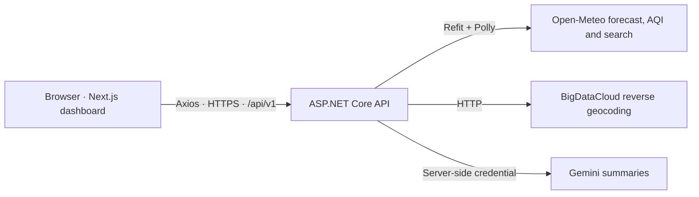

# WeatherWiseAI documentation audit

Scope: local API `cbaddc1` and Web `5b32876` on main. The existing local API settings edit was preserved. Source, project manifests, committed settings keys, repository history and local checks were used as evidence. The [API](https://github.com/Rohit-0310/WeatherWiseAI-API) and [Web](https://github.com/Rohit-0310/WeatherWiseAI-Web) are separate repositories.

## Contract findings

| Area | Current behavior and gap |
| --- | --- |
| Local setup | API launch profile and hardcoded frontend URL agree on HTTPS port 7008. CORS permits only HTTP localhost port 3000. Old frontend base URL env guidance was incorrect |
| JSON shapes | GETs use the shared envelope with nullable meta. AI success is plain JSON and upstream AI errors have a nested error field. Model binding and middleware can return the envelope. Frontend does not parse these errors consistently |
| Units and fields | Metric/Imperial work through forecast requests. AI client sends bare temperature and wind numbers as strings. Client current-weather types include fields not returned by the server. UV/precipitation chance on current weather come from daily maxima |
| Locations and time | Reverse geocoding falls back to a coordinate label and GMT. The frontend and backend require an agreed approach for provider-local timestamps and date boundaries |
| Validation and access | FluentValidation rules are registered but not invoked by the route pipeline. Astronomy DataAnnotations and MVC binding are active. No caller authentication or app-level rate limiting is wired |
| Hosted setup | Environment-based frontend URL and deployment-specific backend CORS are open work. Production and provider access have not been verified |

## Obsolete material corrected

- API: enterprise readiness claims, Swagger at /swagger, domain entities as an existing implementation, Open-Meteo reverse lookup, AI prompt builder wiring, universal validation, a single error shape, and implied provider-independent retries or caching.
- Web: Next.js 15 presented as current, public API URL/key environment examples, Radix UI, weather-driven theme mode, toast/error and retry claims, and Canvas precipitation descriptions. The mobile navigation and unit plan is historical and labeled accordingly.
- Both: initial changelog headings are historical entries, with no local release tags establishing them as published versions. Current functionality and future work are separated in the roadmaps.

## Public contributor and release gaps

Both repositories have an MIT license. Contribution instructions and security reporting guidance were added. No committed issue forms, PR template, GitHub Actions CI, automated test suite or versioned deployment configuration was found. Add bug and feature templates, a PR checklist with test evidence and contract impact, and separate CI that restores locked dependencies where available, builds, and runs tests. Establish private vulnerability reporting, dependency review, supported versions and a release checklist. Keep [Semantic Versioning](https://semver.org/) and note API changes that need coordinated frontend updates. No remote changes or release publication were performed.

Validation and blockers are in the local [API release draft](RELEASE_NOTES_V1.md) and the matching Web repository file `docs/RELEASE_NOTES_V1.md`. Neither is ready for a stable release. Prioritize dependency advisories and API validation, fix the frontend build/type checks, agree on shared contracts and hosted configuration, then exercise the integrated system in CI and a staging environment.

## Recovery of pre-audit sections

Comparison baseline: cbaddc1, immediately before d537813. The entries below locate earlier guidance by topic so contributors can compare it with the implementation.

| Earlier sections | Disposition and current home |
| --- | --- |
| README overview, features, stack, solution layout, prerequisites, installation, environment, running, index and future roadmap | Setup and route list remain in the root README. Project references moved to Architecture. Future milestones live in Roadmap. |
| AGENTS architecture, dependencies, folder responsibilities, naming, feature steps, always/never rules | Restored an actionable workflow. Architecture owns actual dependencies, Coding Standards owns naming, and Development Guide owns service registration and extension steps. Empty Domain folders from the earlier diagram are omitted. |
| Project Rules 1–5, 11–14 and 16 | Restored boundary, DTO, quality, naming, async, DI and provider guidance in Project Rules, Coding Standards and the hourly walkthrough. Runtime call direction and project references are documented separately. |
| Project Rules 6–10 and 15 | Validation, prompts, errors, logging, config and response conventions corrected in their respective reference guides. Uniform envelopes, compulsory prompt builders and automatic validation were inaccurate descriptions. |
| Project Rules 17–20 | Documentation, Git, testability and assistant responsibilities restored to Project Rules, AGENTS and Contributing. |
| Architecture overview, five layers, dependency rules, request/API/AI/prompt flows, mapping, validation, naming | Architecture contains both end-to-end paths. Prompt Engineering covers the inline builder and future work. Naming and validation live in Coding Standards and API Guidelines. |
| Development Guide folder structure, features, controllers, services, integrations, DI, DTOs, validators | Restored as an hourly-field extension workflow with source links, registration example and checks. Uses actual versioned routes and feature-local folders. |
| API conventions, status, naming, versioning, pagination, errors and examples | API Guidelines and Error Handling document real shapes and status codes. Earlier pagination protocol, 429 and upstream 502 assumptions are excluded from the implemented contract. |
| Standards on folders, dependency inversion, SOLID, comments, clean code, async and exceptions | Restored as examples in Coding Standards and Project Rules. Decisions explains trade-offs for the seven original decisions, including actual mapping boundaries. |
| Middleware, validation and integration failures, logging, retries and fallback | Error Handling distinguishes Open-Meteo resilience, reverse-location fallback and Gemini failures. Earlier generic fallback and correlation-ID guarantees are omitted. |
| Prompt templates, builder strategy, temperature, parsing, safety and improvements | Prompt Engineering describes the live template, settings and parse path, with review scenarios. Personas and separate instructions are proposals. Earlier filtering claims lack implementation. |
| Deployment settings, environment overrides, Swagger, publish and production; roadmap phases 1–7 | Deployment retains runnable publishing steps and current constraints. Roadmap maps completed foundation and provider work to outstanding tests, packaging, AI and delivery proposals. |
| Documentation index and initial changelog | Index links to canonical guides. Initial scaffold retained as a historical milestone. Tagged-release status was unverified. |
